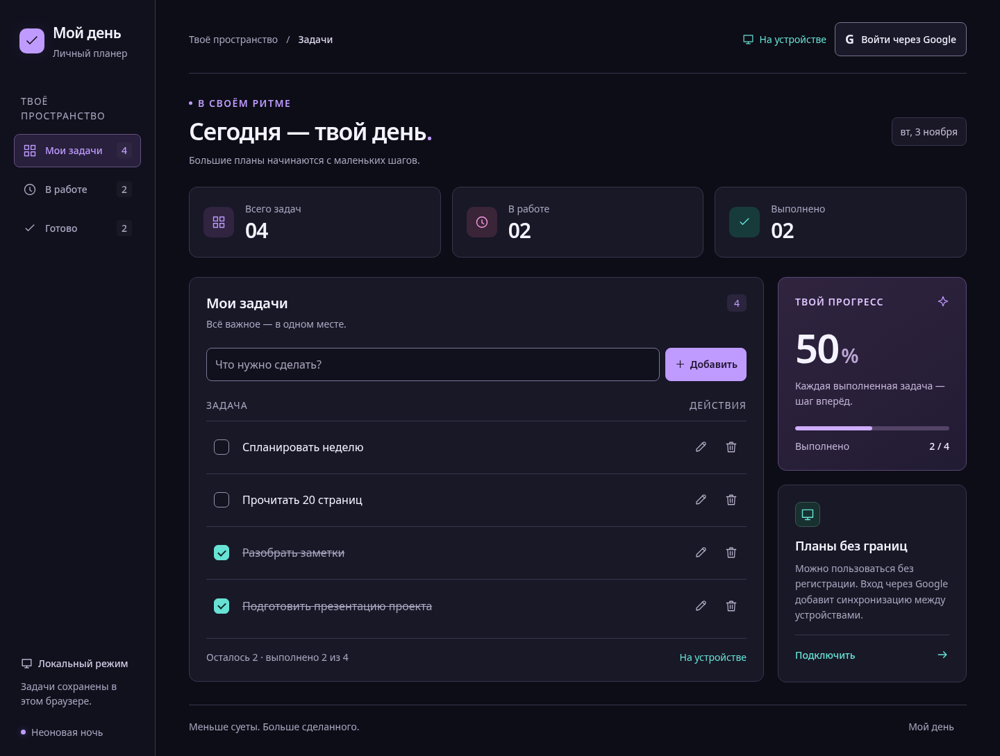

**[🚀 Открыть приложение «Мой день»](https://todo-d0d24.web.app/)**

<div align="center">
  

  <p>
    
    
    
    
    
  </p>

  <p><strong>Планы, задачи и маленькие победы — в одном месте.</strong></p>
  <p>Адаптивный To-Do с локальным хранением и облачной синхронизацией через Google.</p>
</div>

---

## 🚀 О проекте

**«Мой день»** — приложение для личных задач, созданное как тестовое задание. Оно помогает добавлять, выполнять и удалять задачи, сохраняя список после обновления страницы.

Начать можно без регистрации: список хранится в браузере. Вход через Google открывает отдельный личный список в Firestore. При желании локальные задачи можно скопировать в аккаунт — без автоматического переноса.

<div align="center">
  
</div>

---

## ✨ Возможности

| 📋 Задачи                                         | ☁️ Хранение                                                          |
| ------------------------------------------------- | -------------------------------------------------------------------- |
| Добавление, редактирование, выполнение и удаление | Локальный список без регистрации                                     |
| Отмена последнего удаления                        | Личный облачный список после входа через Google                      |
| Фильтры и индикатор прогресса                     | Явное копирование локальных задач в аккаунт без повторных дубликатов |
| Управление с клавиатуры и адаптация под телефон   | Синхронизация локального списка между вкладками                      |

Пустые строки не сохраняются; длина задачи ограничена 300 символами. При ошибке хранения или сети приложение показывает уведомление.

---

## 🏗️ Как устроено

```text
React-интерфейс
      │
      ▼
Состояние и действия ─── Google Auth
      │
      ▼
Контракт TaskRepository
      ├── Локальный репозиторий → localStorage
      └── Облачный репозиторий → Firestore + Rules
```

Интерфейс работает через общий контракт репозитория задач. Локальный и облачный режимы разделены: данные не копируются между ними без явного действия пользователя. Правила Firestore ограничивают доступ к задачам собственным UID и проверяют поля на сервере.

### 📁 Структура проекта

```text
src/
├── domain/tasks.ts          # модель, валидация и контракт репозитория
├── data/local.ts            # локальное хранение и синхронизация вкладок
├── data/cloud.ts            # операции с Firestore и импорт задач
├── data/firebase.ts         # конфигурация Firebase и Google-вход
├── hooks/                   # состояние и действия приложения
├── components/              # список задач, уведомление, иконки
├── App.tsx                  # композиция интерфейса
└── styles.css               # адаптивные стили

tests/                       # модульные, браузерные и security-тесты
docs/                        # Firebase, QA и приёмка
previews/                    # скриншоты интерфейса
dist/                        # готовая production-сборка
firestore.rules              # правила доступа Firestore
```

---

## 🛠️ Технологии

| Технология                  | Назначение                                                              |
| --------------------------- | ----------------------------------------------------------------------- |
| **React 19 + TypeScript**   | Интерфейс, компоненты и типизация                                       |
| **Vite 7**                  | Локальная разработка и сборка                                           |
| **Firebase Authentication** | Вход через Google                                                       |
| **Cloud Firestore + Rules** | Личный список и проверка доступа                                        |
| **Firebase Hosting**        | Публикация приложения                                                   |
| **Playwright + axe**        | Браузерные сценарии и автоматические проверки доступности               |
| **Firestore Emulator**      | Проверки облачного репозитория и правил без обращения к production-базе |

---

## ⚡ Быстрый старт

Нужны **Node.js 22.12+ или 24 LTS** и npm.

```bash
git clone https://github.com/Masterfar7/ToDo_List.git
cd ToDo_List
npm ci
npm run dev
```

Открой адрес, который покажет терминал. Без настройки Firebase приложение работает в локальном режиме.

### Google-вход и Firestore

1. Скопируй `.env.example` в `.env.local` и заполни публичную веб-конфигурацию Firebase.
2. Включи Google-провайдер в Authentication и создай базу Firestore `(default)`.
3. Добавь домен приложения в Authorized domains.

Подробная настройка — в [docs/FIREBASE.md](docs/FIREBASE.md). `.env.local` исключён из Git; не помещай в него ключи сервисного аккаунта или пароли.

### Production-сборка

```bash
npm run build
npm run preview
```

Готовая сборка находится в `dist/`. Открывай её через веб-сервер, а не через `file://`.

---

## 🧪 Проверки

```bash
npm run format:check
npm run check
npm test
npx playwright install chromium
npm run test:e2e
npm run test:security
```

| Проверка            | Результат последнего локального прогона        |
| ------------------- | ---------------------------------------------- |
| Модульные тесты     | **16 из 16**                                   |
| Браузерные сценарии | **44 из 44** на desktop и mobile viewport      |
| Firestore Emulator  | **31 проверка** облачного репозитория и правил |

Для Firestore Emulator требуется **Java 21+**. Браузерные сценарии аккаунта используют имитацию авторизации и хранилища; они не заменяют проверку реального Google-входа. Автоматические проверки доступности не являются сертификацией WCAG.

Подробности и ограничения — в [docs/QA.md](docs/QA.md); ручная приёмка — в [docs/ACCEPTANCE.md](docs/ACCEPTANCE.md). Конфигурация GitHub Actions находится в `.github/workflows/ci.yml`.

---

## ☁️ Публикация в Firebase Hosting

После настройки `.env.local` и сборки из папки проекта в Windows:

```powershell
npm run build
npx.cmd firebase-tools login
npx.cmd firebase-tools deploy --project todo-d0d24 --only "hosting,firestore:rules"
```

**Публикуй Hosting и правила Firestore вместе:** актуальные правила нужны для восстановления и импорта выполненных задач. Для другого Firebase-проекта укажи свой project ID. После публикации проверь вход и работу с задачами по чек-листу приёмки.

---

## ⚠️ Ограничения

- Локальный список привязан к браузеру, профилю и домену; очистка данных браузера удалит его.
- Полноценный offline/PWA-запуск не заявлен. Облачные изменения и Google-вход требуют сети.
- Отмена доступна до закрытия уведомления, следующего удаления, смены аккаунта или перезагрузки страницы.
- Облачная задача при восстановлении получает новое время создания, но сохраняет ID, текст и состояние.
- Копирование в аккаунт не является непрерывной двусторонней синхронизацией. Исходные локальные задачи остаются на устройстве.
- Постоянный offline-кэш Firestore не включён. Для широкого публичного запуска потребуются отдельные меры против злоупотреблений и политика конфиденциальности.

<div align="center">
  
</div>
